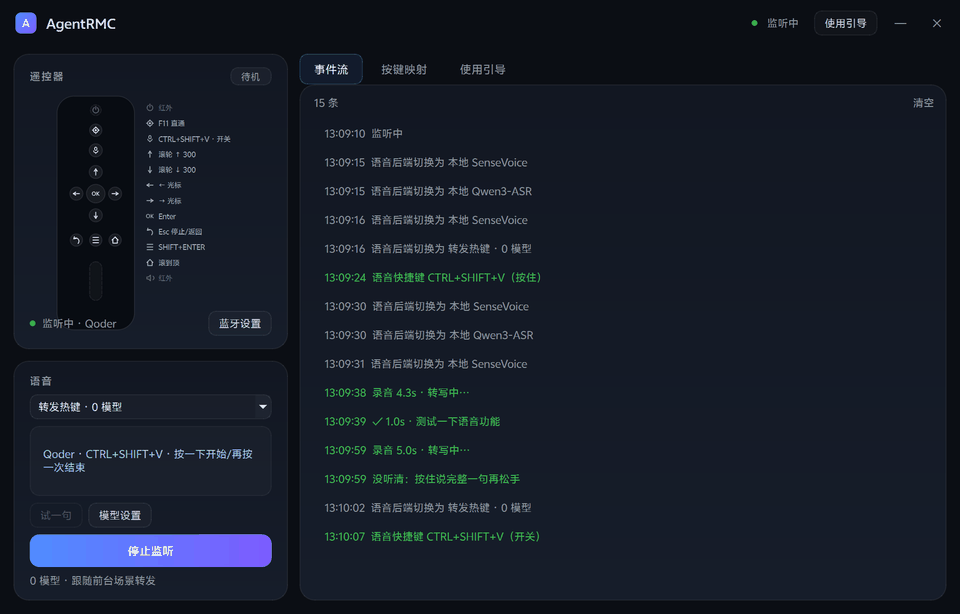

# AgentRMC

把极米 / 快乐星球投影仪遥控器改造成电脑 Agent 的输入终端：按键走标准 HID（零驱动），
语音交给前台 Agent 自己的语音键或本地模型转写，键映射按前台窗口自动切换，
蓝牙耳机播放键也能当语音开关。

实测机型为极米「快乐星球 O3」13 键 BLE 遥控器（VID `0x000D` / PID `0x3838`）；
同款 HID 遥控器改 `config.json` 的 `device_mark` 即可复用。

当前实现是 **C++/Qt 6 原生版**（`native/`，v0.2.0；按键映射不接 LLM，动作直接交给 Qoder / WorkBuddy 服务端；只有桌宠对话模式会调用你在「对话设置」里自配的 LLM）。
Python 版留在 `legacy-python` 分支，两版读写同一套 `config.json` / `profiles.json`。



*经典主题 ⇄ 鲸鱼娘主题：形象、背景、音色整套切换，主题包即拖即用（见「主题系统与自定义应用」）。*

```
遥控器 → HID → Raw Input ─┬→ 按键 → 场景 Profile → 动作（按键/滚动/鼠标/模式/启动程序）
蓝牙耳机 → AVRCP 注入键 ──┘
                           └→ 语音键 → 一套状态机 → ┬→ 转发 Agent 语音热键（默认，0 模型）
                                                    ├→ 本地 SenseVoice / Qwen3-ASR 转写 → 粘贴
                                                    └→ 耳机播放键 = 同一个开关（无 keyup，只能切换）
```

## 下载

不想自己构建的话，装这两个文件就够了（安装包约 20MB，模型包约 159MB）：

| 网盘 | 链接 |
|---|---|
| 夸克 | <https://pan.quark.cn/s/47bf9d92c5f5> |
| 百度 | <https://pan.baidu.com/s/1aBSAtOlzUX-Ih8rbLC5MVA?pwd=35c8>（提取码 `35c8`） |

先装 `AgentRMC-Setup.exe`；再把 `SenseVoice语音模型.zip` 拖进窗口（或「模型设置 → 导入模型包…」）
装上本地转写——**不装模型也能用**，默认路线是转发 Agent 自己的语音快捷键、0 模型。
Windows 10/11，普通用户权限即可。

可选升级：网盘里还有 **Qwen3-ASR 模型包**（`sherpa-onnx-qwen3-asr-0.6B-int8-2026-03-25.tar.bz2`，
约 880MB），同一个链接里下载后直接拖进窗口导入，再在「模型设置 → 识别方式」切到
**本地 Qwen3-ASR**——中英混合和中文识别明显更准，代价是转写比 SenseVoice 慢一些。
导入认的是包里的模型文件，用原包（.tar.bz2）直接拖就行，不要再套一层压缩包。

## 快速开始

```bat
git clone https://github.com/Samuel5945/AgentRMC.git && cd AgentRMC

rem 需要 Visual Studio（MSVC + 自带 CMake），Qt 6.8.3 msvc2022_64 装在 native\.qt\
native\tools\build.bat                       rem 构建（lean 变体：build.bat lean）
native\build\Release\AgentRMCNative.exe      rem 运行：启动即监听，关窗收进托盘
```

可选的本地转写——不装也能用，默认路线是转发热键、0 模型：

```bat
native\tools\download_voice_models.bat runtime       rem sherpa-onnx 运行库，约 20MB
native\tools\download_voice_models.bat sensevoice    rem SenseVoiceSmall int8，下载 158MB
native\tools\download_voice_models.bat qwen3         rem Qwen3-ASR 0.6B，下载 838MB（可选）
```

`config.json` / `profiles.json` 放在 **exe 同目录**（首次构建从仓库根播种，之后保留你自己的改动）。
构建细节、工具链和体积构成见 [native/README.md](native/README.md)。

## 项目结构

```
AgentRMC/
├── native/                 ← 当前实现（C++/Qt 6 + sherpa-onnx）
│   ├── src/core/           InputEngine（Raw Input + 钩子）、KeyRouter、Injector、
│   │                       VoiceController、AsrEngine、AudioRecorder、ProfileStore、Presets、
│   │                       AppLauncher（按名字找应用并启动）
│   ├── src/ui/             遥控器卡片、按键映射页、应用页、语音设置、使用引导、Toast、
│   │                       ToggleSwitch、矢量键位图标（KeyIcon）
│   ├── tests/              无头自测（store / router / takeover / voice / app / audio / asr）
│   ├── tools/              build.bat、download_voice_models.bat
│   ├── models/             本地模型（git 忽略，需自行下载）
│   ├── third_party/        sherpa-onnx 预编译库（git 忽略）
│   └── README.md           迁移记录、里程碑、工具链、构建与体积
├── config.json             语音键码、耳机键、麦克风与 ASR 参数（开发期默认值）
├── profiles.json           场景表（按前台窗口切换键映射，支持 extends / 双击 / 长按 / 导航键表）
├── commands.json           任意语音指令表（只有 Python 线读；原生线用内置的「打开应用」，见下）
├── rc_probe/               探测与验收脚本，保留作协议分析参考
│   ├── media_probe.py         低层钩子 + Raw Input 双路记录媒体键（只读）
│   ├── sim_avrcp.py           模拟耳机 AVRCP 注入帧（带 INJ、只发 keydown）
│   ├── dump_gatt_winrt.py     枚举 GATT 服务表
│   ├── hid_caps.py            读 HID 报告能力
│   ├── learn_keys.py          交互式按键学习（换遥控器时重新校准）
│   ├── rawreport.py           提权读 256 字节透传包
│   ├── nolegacy_probe.py      NOLEGACY + SendInput 行为（单进程）
│   ├── nolegacy_probe2.py     NOLEGACY 的抑制范围（跨进程）
│   └── uia_probe.py           读 Electron 窗口的 UIA 树（TTS 前置调研）
├── tests/                  Python 线无头测试
├── tools/                  Python 线的 setup / run / build 脚本
├── agentrc.py / agentrc_gui.py / legacy/   历史 Python 线（完整文档在 legacy-python 分支）
└── assets/                 应用图标与配对示意图
```

## 设备

| 项 | 值 |
|---|---|
| 蓝牙名 | `BLuetooth 4.0 RC` |
| MAC | `70:FD:88:CE:60:EC` |
| VID / PID | `0x000D` / `0x3838` |
| 厂商 | Realtek BT |
| 固件 | `B951C_HBG2_JH_V1.1.2` |
| HID Usage | `0x0001` / `0x0006`（Generic Desktop / Keyboard） |
| Appearance | `0x0180`（Generic Remote Control） |
| 来源 | 极米 / 快乐星球投影仪配套遥控器（实测极米「快乐星球 O3」，13 键） |

## 探测结论

### GATT 服务表

| 服务 UUID | 内容 | 结论 |
|---|---|---|
| `0x1812` | HID over GATT | 被 Windows HID 驱动独占，用户态读不到原始报告 |
| `0x180F` | Battery | 可读，正常上报电量 |
| `0x180A` | Device Info | 可读，拿到型号/固件 |
| `0xD1FF` | `A001`(write+notify) / `A002`(write) | 厂商私有。**可订阅，但按住语音键时无音频数据** |
| `0xD0FF` | `ffd1`~`ffe0` | 厂商私有，MAC/参数，无 notify 特征 |
| `0x6287` | `6387`(write) / `6487`(write+notify) | 厂商私有，无数据 |

订阅 `D1FF/A001` 后只收到一个 16 字节全零握手包，之后 4 分钟内零音频。**遥控器麦克风的音频没有走这条通道。**

### 按键：完全标准，零改造可用

遥控器的按键走标准 HID 键盘协议，Windows 原生识别，不需要任何驱动或破解：

| 物理键 | vkey | 扫描码 | Windows 键名 |
|---|---|---|---|
| 上 | 38 `0x26` | `0x48` | `Up` |
| 下 | 40 `0x28` | `0x50` | `Down` |
| 左 | 37 `0x25` | `0x4B` | `Left` |
| 右 | 39 `0x27` | `0x4D` | `Right` |
| OK | 13 `0x0D` | `0x1C` | `Enter` |
| 返回 | 27 `0x1B` | `0x01` | `Esc` |
| 菜单 | 93 `0x5D` | `0x5D` | `Apps` |
| 主页 | 36 `0x24` | `0x47` | `Home` |
| 语音键 | 116 `0x74` | `0x3F` | `F5`（**按住连发**） |
| 变焦 / 对焦 | 122 `0x7A` | `0x57` | `F11`（应用里就是全屏切换） |
| 音量 + / 音量 − / 电源 | — | — | **电脑上收不到任何报文**，见「已知限制 2」 |

### 语音键的识别特征

语音键不是"按一下发一个码"，而是**按住期间以约 31ms 间隔连续发送 keydown**，松手才发 keyup。这个特征正好可以用来区分遥控器和实体键盘：

```
keydown  keydown  keydown  ...  keydown   keyup
  0ms     31ms     62ms          2.4s
```

程序利用它做判定：第一次 keydown 先挂起 250ms，若期间收到第二次，判定为长按并开始语音；
否则说明只是轻点了一下，**什么都不做**——原生 F5 已经由 Windows 送给前台窗口了，
再补发一次只会让浏览器刷新两下。

> 这里很容易误判成"要帮实体键盘转发 F5"。不会：Raw Input 已经按设备路径过滤，
> 只收遥控器的报文，实体键盘的 F5 根本不进这个状态机。

## 架构

```
┌────────────────────────────────────────────────────────────┐
│  BLE 遥控器 (HOGP)         蓝牙耳机 (AVRCP → 注入键)       │
└───────────────┬───────────────────────────┬────────────────┘
                │ 标准 HID 键盘报告          │
┌───────────────▼───────────────────────────▼────────────────┐
│  Windows HID 驱动 / 蓝牙 AVRCP 服务                        │
└───────┬───────────────────────────────────────────┬────────┘
        │ Raw Input（按设备路径过滤，只收遥控器）   │ WH_KEYBOARD_LL
┌───────▼────────────────────────────────────────────────────┐
│  AgentRMCNative.exe   C++/Qt 6 Widgets                     │
│                                                            │
│  InputEngine ──▶ KeyRouter ──▶ Injector                    │
│   单击 / 双击 / 长按 · 连发加速 · 音量·鼠标·导航模式 · 接管 │
│        │                                                   │
│        └──▶ VoiceController（一套语音键状态机，四条路线共用）
│             转发热键 │ SenseVoice │ Qwen3-ASR │ 耳机开关   │
│                      └─ AsrEngine（sherpa-onnx C API）     │
│  ProfileStore / Presets（同一套 config.json、profiles.json）
└────────────────────────────────────────────────────────────┘
```

| 模块 | 职责 |
|---|---|
| `core/InputEngine` | Raw Input 收键 + 设备过滤 + 低层钩子吞键，两路喂同一个 Router |
| `core/KeyRouter` | 单击 / 双击 / 长按 / 连发加速 / 模式切换 / 双击判定窗 |
| `core/Injector` | SendInput 按键、滚动、鼠标、启动程序、显示器亮度 |
| `core/NativeHooks` | `WH_KEYBOARD_LL`：接管映射键、鼠标模式、耳机播放键判定 |
| `core/VoiceController` | 语音键状态机：按住 / 切换、耳机开关、静音兜底、3 秒自测、粘贴 |
| `core/AsrEngine`、`core/AudioRecorder` | sherpa-onnx 转写；WinMM 录音 + 重采样（Qt 6.8 没带 Multimedia） |
| `core/ProfileStore`、`core/Presets` | 配置与场景读写、动作预设、写回前自动 `.bak` |
| `src/ui/*` | 遥控器卡片、按键映射页、语音设置、使用引导、Toast、ToggleSwitch、矢量键位图标 |

## 用法

### 首次准备

遥控器第一次配对：把它靠近要连接的设备，**同时长按「返回」+「主页」约 3 秒**，指示灯快闪后
在系统蓝牙列表里点它。配对过一次之后不用再配，按一下任意键就会自动回连。
软件里点顶栏 **使用引导** 会弹出图文版步骤：先选路线——**有遥控器**走
配对示意图 + 四步配对 + 常用手势 + 模式说明 + 已知限制，**没有遥控器**走
语音路线（热键 / 麦克风 / 转写说明），点「进入语音主界面」直接切过去；
卡片上的 `蓝牙设置` 直接打开系统的蓝牙设置页。

> 只需要普通用户权限，不需要管理员。

### 界面

单窗口两栏，Qt Widgets + 一份 QSS：

- **左上 · 遥控器卡片** —— 按真实键位画的矢量键位图：按下实体键时对应键和右侧表格行同时高亮，
  底部显示刚触发的「键位 · 动作」；右侧按当前场景列出生效映射，改完立即刷新；
  徽标随状态切 `待机 / 监听中 / 模式名`；电源键与音量拨杆标灰（红外，电脑收不到）
- **左下 · 语音卡片** —— 状态与当前接法（例：`Qoder · CTRL+SHIFT+V · 按一下开始/再按一次结束`）、
  `测试 3 秒`、`模型设置`、最近一次转写（超长截断，悬停看全文）、事件条数与 `清空`
- **右 · 四页签** —— `事件流`（可清空）、`按键映射`、`应用`、`使用引导`
- **顶栏** —— 状态点 + `监听中 / 未监听` + 当前场景，右侧 `使用引导` 和窗口按钮
- **托盘** —— 左键唤回界面并置前；右键 显示主界面 / 语音面板 / 隐藏到托盘、开始监听 / 停止监听、退出；
  窗口 `✕` **只是收进托盘，监听继续**（`ui.close_to_tray` 设 false 则关窗即退出）

### 语音主界面（无遥控器）

语音卡片点 **语音主界面**（或托盘「语音面板」）切到一个简洁小窗，语音是唯一主角：

- **大麦克风按钮** —— 点击开始、再点结束；录音中绿环随麦克风电平呼吸；说完停嘴 6 秒自动收尾。
  本质和耳机播放键是同一套状态机，遥控器语音键照常并行可用
- **全局键盘热键** —— 默认 `Ctrl+Alt+V`（语音设置里可换/可关），任何界面下一键开始/结束说话；
  没有**遥控器也能完整用语音**，这是给没配遥控器的机器准备的入口
- **转写结果** —— 最新一句大字展示，点击复制；下方保留最近 30 条，点击任意一条复制回剪贴板
- **底部快捷行** —— 引擎切换（转发 / SenseVoice / Qwen3-ASR）+ 模型设置
- 顶栏「完整界面」一键切回主窗；记住上次的选择（`ui.voice_mode`），下次启动直接进语音主界面

### 语音桌宠

主窗（或语音面板）的 `✕` 收起时，屏幕右下角会弹出一个 **语音桌宠小球**，开机自启只留托盘时
它就是程序在桌面上的「脸面」（`ui.pet_enabled`，默认开；托盘菜单「语音桌宠」可开关）：

- **状态一眼可见** —— 未监听灰环、监听中蓝环呼吸、录音中绿环随麦克风电平加粗、转写中黄圈旋转
- **单击球体** —— 没监听就先开始监听；监听中就是开始/结束说话（和耳机播放键同一套状态机）
- **悬停展开卡片** —— 识别方式切换（转发 / SenseVoice / Qwen3）、最近转写（点击复制）、
  面板 / 主界面 / 贴边 / 关闭 四个快捷按钮；右键菜单是同样的操作
- **贴边隐藏** —— 直接把球拖到屏幕边缘（80px 内吸附），或点卡片上的「贴边」；
  藏起来只露一条 20px 的边条，鼠标碰上去就弹出，离开 1.6 秒再缩回去
- **关闭** —— 卡片或右键菜单里的 `✕` 会记住关闭状态，想再叫出来走托盘菜单「语音桌宠」

**语音反馈（TTS，OpenAI 兼容协议）**：桌宠接了 TTS 出声，默认对准
[MiMo-V2.5-TTS](https://mimo.mi.com/models/zh-CN/mimo-v2.5-tts)（限时免费）。
**Base URL / API Key / TTS 模型 / 音色全部用户自填**，不会随仓库分发：

- **自填入口**：语音主界面底部「语音反馈」，或语音设置里的「桌宠语音反馈 → 设置…」，
  两处开的是同一个对话框，含「试听」按钮（不保存也能先验证 key 和模型）
- Base URL 填 OpenAI 兼容根地址（默认 `https://api.xiaomimimo.com/v1`），
  换成 OpenAI / 硅基流动 / DashScope 等同样可用；模型名可直接改
  （mimo-v2.5-tts / gpt-4o-mini-tts / tts-1 / cosyvoice-v2…）
- Key 只落本机 `config.json` 的 `voice.tts.api_key`，也可以设环境变量
  `MIMO_API_KEY` 不落盘
- 音色可「跟随主题」：主题包 `theme.json` 的 `voice` 节点带 `name`（音色 ID，
  如 MiMo 的 冰糖 / Chloe）和 `style`（嗓音语气描述），选「跟随主题」后音色名
  与描述都取当前主题的，换主题/主题轮播立即跟着换；主题没写 `name` 时回落
  Chloe——指令驱动的 TTS 只有钉死音色名才不会每句都漂
- 出声时机：桌宠可见时切识别方式、复制、打开应用的确认，以及右键菜单「朗读最近一句」；
  右键菜单的「语音反馈」随时开关（写回 `voice.tts.enabled`）
- 没填 key 就只有气泡不出声；合成失败（如余额不足）气泡提示一次，不刷屏
- 手动自检：`AgentRMCNative.exe --tts-test "你好" --tts-save out.wav`（保存 WAV 便于验证）

**桌宠对话闭环（LLM）**：右键桌宠开「对话模式」（`ui.pet_chat` 持久化）后，
说话 → 转写（本地或云端）→ 发给 LLM → 回复用气泡展示 + TTS 念出来，
**不再粘贴到输入框、也不触发应用启动**。带最近 4 轮对话记忆，开关在语音主界面「对话」按钮和桌宠右键菜单，桌宠收起后回复仍以语音给出（文字落语音面板/事件流）。
配置走右键「对话设置…」：`voice.llm_api.{base_url, api_key, model, system}`，
base_url / key 同样留空沿用 TTS 的，模型默认 `mimo-v2.6-flash`（快，适合语音对话），
「人设」可自定义回复风格。对话模式下切回转发（hotkey）路线时对话不生效——
那条路线上语音根本不经过本程序。

`ui.pet_enabled`（默认 true）控制桌宠是否自动弹出。

`ui.auto_listen`（默认 true）启动即监听；`ui.start_minimized` 启动就藏进托盘、不抢 Qoder 的焦点；
`ui.voice_launch`（默认 true）= 语音里的「打开 xx」当启动指令，见「语音打开应用」。
单实例互斥量与 Python 版共用：另一版在跑时点「开始监听」会提示 `AgentRMC 已在运行`，
避免每个键注入两次。跨屏与缩放：PassThrough DPI（175%/225% 不取整）+ 原生拖动 +
切屏回夹 + 几何记忆。

模式提示：进入音量 / 鼠标 / 导航模式时，鼠标所在屏幕底部居中弹 2 秒置顶提示
（进入给操作说明、退出给已退出提示），不抢焦点。

### 按键映射页

右侧切到 **按键映射**，按物理键列出当前场景的完整映射。顶部场景行用
**绿点 = 跟随前台命中 / 橙点 = 下拉框钉住**，后面是命中该场景的进程或标题；
下面是 `键位 / 单击 / 双击 / 长按` 四列，分成 方向键、功能键、语音与直通 三组。

**单击、双击、长按三个单元格都可以直接点**，弹出常用动作预设（导航键、滚动、浏览器、
编辑器、系统、鼠标、启动应用、双击模式、按住重复/按住动作）。菜单最上面的 **`自定义组合键…`**
弹出一个录入框，**在键盘上按下想要的按键/组合（可含 Ctrl/Shift/Alt/Win）直接录入**，
不用碰 JSON；Esc 取消。选完立刻写回 `profiles.json` 并热重载，同时保留上一版
`profiles.json.bak`。语音键和对焦键是固定行为（语音接法 / F11 原生直通），单元格不可编辑。

| 元素 | 说明 |
|---|---|
| 场景行 | 绿色点 = 跟随前台自动命中；橙色点 = 固定预览。后面的匹配规则说明为什么命中（进程名 / 窗口标题，悬停看完整列表） |
| 下拉框 | 默认 `跟随前台`，切窗口时表格自动跟着变；也可以钉住某个场景预览 |
| `键位` | 遥控器物理键：`↑ ↓ ← → OK 返回 菜单 主页 语音 对焦` |
| `单击` | 场景解析后的动作，下面一行是实际按键/效果，如 `滚轮 ↑ 300`、`Enter 直通`、`CTRL+T`；点格改动作 |
| `双击` | 默认是 Router 内置手势：返回=`音量/亮度模式`、菜单=`鼠标模式`、主页=`导航模式`。点格可以改成任意预设，或 `关闭双击`；改成其它动作后单击会延迟 0.3s 等第二击 |
| `长按` | 默认继承动作自带的 `hold_repeat` / `hold_action`；点格可以改成 `连续触发`、`连续加速`、`按住某动作` 或关闭。语音键固定 `按住说话` |
| 行联动 | 点选或悬停一行，左侧遥控器图上的对应键会亮起蓝环，眼不用在两个面板之间找 |
| 接管原生键 | 右下角开关：当前前台场景的映射键原生事件被低层钩子吞掉，再按映射注入。实体键盘同名键也会按映射处理，双击键的单击延迟约 0.3s；默认关 |
| `高级配置` | 用默认编辑器打开 `profiles.json`（匹配规则、自定义动作等） |
| `重新加载` | 改完 json 不用重启程序，点一下热加载 |

导航模式（qoder / agent）：默认双击主页进入，`↑↓` 翻页、`←→` 切换控件，单击主页退出；
也可以在上面的双击格里改成其它动作。

> 双击格的动作会延迟 0.3s 等第二击；不接管原生键时原生那一份仍立即触发（所以返回/菜单/主页单击不会丢）。
> 打开接管后原生被吞，单击才真正延迟。

窗口变矮时表格纵向滚动；窗口极窄时保持四列不挤压，横向滚动兜底。正常 1000×680 窗口没有滚动条。

### 命令行与界面验收

```bat
native\build\Release\AgentRMCNative.exe --pin qoder                    rem 固定预览某场景
native\build\Release\AgentRMCNative.exe --shot out.png --tab 1         rem 离屏渲染整窗截图
native\build\Release\AgentRMCNative.exe --shot-settings dialog.png     rem 截语音设置对话框
native\build\Release\AgentRMCNative.exe --shot-guide guide.png         rem 截使用引导
```

`--shot` 系列不会启动监听，也不抢单实例，专门用来做界面验收。

### 构建

```bat
native\tools\build.bat              rem 完整构建 + windeployqt
native\tools\build.bat lean         rem 只打 hotkey 包（不链 sherpa 运行库）
```

工具链（MSVC + CMake + Qt 6.8.3）、手动 cmake 命令、`windeployqt` 会删掉哪些无用 DLL、
以及各部分体积构成，见 [native/README.md](native/README.md)。

### 自测

```bat
native\build\Release\AgentRMCStoreTest.exe
native\build\Release\AgentRMCRouterTest.exe
native\build\Release\AgentRMCTakeoverTest.exe
native\build\Release\AgentRMCVoiceTest.exe
native\build\Release\AgentRMCAudioTest.exe 2 rc_probe\mic_test.wav
native\build\Release\AgentRMCAsrTest.exe native\models\sensevoice\test_wavs\zh.wav native\models\sensevoice sensevoice
```

覆盖：预设写回、`.bak`、同键原生去重、`extends` 继承、custom 动作；Router 的滚动 / tap /
双击 / 长按 / 媒体 · 导航 · 鼠标模式；接管下的直通补发、连发补发、模式标记和钩子吞键判定
（含耳机键）；语音后端解析、WAV 头、SenseVoice / Qwen3 模型发现；真实麦克风采集
（1 秒预热、400ms 预录、松手等最后一块）；以及 SenseVoice 端到端转写（第二次为热态延迟）。
`AgentRMCAsrTest` 只在启用 sherpa 时生成。

> 无头测试全绿不等于输入链路对：耳机键这类只在真机出现的差异，用
> `rc_probe/media_probe.py`（只读记录低层钩子 + Raw Input）配
> `rc_probe/sim_avrcp.py`（注入一帧带 `INJ`、只发 keydown 的 `0xB3`）做 A/B 复现。

## 主题系统与自定义应用（v0.2.0）

界面形象、背景、配色、音色是一套可切换的「主题」，入口在 **语音设置 → 主题** 下拉
和 **桌宠右键 → 主题**，切换即时生效：

- **经典**：默认深色配色 + 代码绘制的圆球桌宠；
- **鲸鱼娘**：Q 版鲸鱼娘桌宠（idle / 监听 / 录音 / 转写 / 对话五个状态各 2 帧动画，
  萌系治愈少女音）、深海背景 + 半透明卡片、专属人设——对话模式里她就是「鲸鱼娘」。

音色跟随主题：主题可自带 `voice.style` 音色描述（鲸鱼娘=萌系治愈少女音），你在
TTS 设置里自己写的「音色描述」优先级更高。音色下拉支持 Chloe（默认）/ 跟随主题 /
自定义手输，「音色描述」支持文字定制嗓音（试听即时验证）。

**主题包**就是一个文件夹：`theme.json`（清单+配色+人设+音色）+ `pet/` 状态帧 +
`backgrounds/` 背景 + `preview.png`。把文件夹丢进程序目录的 `themes\`，或
「桌宠右键 → 主题 → 导入主题包…」选一个 .zip 自动装好；同名主题 = 更新。
生成新主题形象可以用 `tools/theme/gen_theme.py`（ComfyUI + Qwen-Image 2.1
参考图直出透明 PNG，`character_backgrounds.py` 生成带角色的背景）。

**自定义应用**：「应用」页 → 添加应用，填名称和一个 exe/快捷方式/网址路径，
说「打开 名称」即可启动（可配别名），按键映射的「打开 xx」动作下拉也会自动带上。
内置表含 Chrome / Edge / Qoder / WorkBuddy / DeepSeek / Codex / ZCode / 剪映 /
PS / PR / AI / OpenSquilla 等。对话模式不再随桌宠收起退出：桌宠收起后回复仍以
语音给出，文字落语音面板与事件流。

## 语音打开应用（v0.2.0）

本地识别（SenseVoice / Qwen3）转写出来的这句话，先当**启动指令**过一遍：命中就直接启动应用，
不再往输入框里贴字。说法去掉标点、空格和「帮我 / 请 / 一下 / 吧」这类填充词后，等于
「打开 / 启动 / 运行 / 开启 / 切换到 / 回到 / 调出 / 开」+ 应用名才算指令，所以
「帮我打开剪映吧」会启动，「打开浏览器以后帮我查一下天气」仍然照正常流程粘贴。

| 应用 | 能说的名字 |
|---|---|
| 浏览器（默认浏览器） | 浏览器 / 默认浏览器 / 网页 / browser |
| Chrome | chrome / 谷歌浏览器 / 谷歌 |
| Edge | edge / 微软浏览器 |
| Qoder | qoder / coder |
| Qoder CN | qoder cn / qodercn / qoder 中国版 / qoder 中文版 |
| WorkBuddy | workbuddy / work buddy / 工作伙伴 |
| DeepSeek | deepseek / deep seek / 深度求索 / 深度搜索 |
| Codex | codex / chatgpt / chat gpt / gpt / openai |
| ZCode | zcode / z code |
| 剪映 | 剪映 / 剪映专业版 / jianying / jianyingpro |
| Photoshop | photoshop / ps / adobe photoshop |
| Premiere Pro | premiere / pr |
| Illustrator | illustrator / ai |

内置表之外，**开始菜单里的应用按名字原样说就能开**（递归扫 `%APPDATA%` 与 `%ProgramData%`
的 Start Menu\Programs，忽略卸载类快捷方式），例如「打开 WorkBuddy AI」。装完新软件后
在「应用」页点「重新扫描」即可。带尾巴的名字也认：`PotPlayer 64 bit` 说「打开 potplayer」
就行；说岔了同样有拼音容错（「打开逗包」能开「豆包」），防误启动的守卫一致生效。

启动方式按能不能找到东西依次尝试：开始菜单 `.lnk`（`ShellExecuteW`）→ Windows 应用
AUMID（`explorer.exe shell:AppsFolder\…`）→ 默认浏览器走注册表 `http` 关联拿到的真实 exe，
拿不到就退回打开一个网页。没装就报「这台电脑上没装 xx」，事件流里红字可见。

**中英混合不怕说岔**：SenseVoice 选「识别语言：自动 · 中英混合」（`voice.asr_language`，
语音设置里可改）后英文应用名不会被硬翻成汉字；就算识别引擎还是把名字听岔了，模糊匹配
会按三种口径在内置表里找最接近的——原样编辑距离（英文）、声母骨架（`WOKBER` / `WRK八点`
→ WorkBuddy、`剪易` / `简验` → 剪映）、全拼骨架（`简面` ≈ 剪映，门槛更高）；汉字按拼音
参与比对（内置 20892 字拼音表，`native/tools/gen_pinyin.py` 生成）。要求分数够高且明显
甩开第二名才启动，所以「打开第二个」「打开zcode设置」「打开剪映专业版设置」这类口述不会
被误当成指令。

> 转发热键路线（默认，0 模型）没有本地文本，语音整个交给 Qoder / WorkBuddy 自己识别，
> 所以语音启动只在本地识别下生效。不想装模型又想一键开应用，用下面的按键映射。
>
> 反过来说，这句话被当成指令就不会再贴进输入框。想对着 Agent 口述「打开剪映」这种内容时，
> 在「应用」页右下角关掉 **语音启动**（`config.json → ui.voice_launch`，默认开）。

**不用语音也能开**：「按键映射」的单击 / 双击 / 长按菜单里都有「启动应用」，选完写回
`profiles.json`，动作是 `{"type": "launch", "app": "qoder"}`，由 KeyRouter 直接调起。
「应用」页则列出每个应用的安装状态和来源，可以点「打开」当场试。

Python 线的 `commands.json` 是另一套东西（任意关键词 → `run` / `key` / `paste`），
**原生版不读它**；启动应用这条能力已经内置，不需要指令表。

## Agent 会话通知与桌宠交互（ZCode 联动，v0.2.0）

程序在本机回环监听 `127.0.0.1:45915`（AgentBridge），三个口子：

- `POST /notify`：JSON `{"event":"stop|permission|...","title":"...","message":"..."}`，
  桌宠冒气泡（不出声，不打断在放的音频）；桌宠收起时改走托盘气泡；事件流里留一条
  「ZCode · …」。
- `POST /speak`：JSON `{"message":"..."}`，桌宠冒气泡并 TTS 朗读（桌宠收起也照念）。
- `GET /state`：返回桌宠状态 JSON（`pet_visible / docked / listening / recording /
  transcribing / chat_mode / tts_ready`）。

端口被占用时只是放弃监听，不影响其它功能。

### ZCode 插件（推荐给其他用户）

`plugins/agentrmc-bridge/` 是打包好的 ZCode 插件（hooks + MCP + skill，全部零依赖
node 脚本，安装包已带在程序目录 `plugins\` 下）：

- **hooks 自动提醒**：ZCode 需要确认工具调用（PermissionRequest）时桌宠冒气泡；
  一轮回答结束（Stop）时桌宠念「ZCode 已完成…」（TTS）并把 ZCode 主窗口拉到
  前台——任务一般很长，完成值得出声。AgentRMC 没开就静默跳过（实测 <100ms），
  不拖慢会话。
- **MCP 主动交互**：三个工具——`pet_notify`（阶段进度气泡）、`pet_speak`（让桌宠
  TTS 说一句话）、`pet_state`（查桌宠状态），随附 `agentrmc-pet` skill 约束使用
  礼仪（一句话以内、不刷屏、完成提醒不重复发）。

安装：ZCode → 插件市场 → 添加 → 选本仓库 `plugins/` 目录（或安装目录里的
`plugins\`）→ 安装「AgentRMC 桌宠联动」。前提：node 在 PATH、AgentRMC ≥ v0.2.0。

### 手工接入（不用插件时）

hook 脚本在 `native/tools/zcode-hook/agentrmc-notify.js`，复制到固定位置（如
`C:\Users\PC\.zcode\hooks\agentrmc-notify.js`），在 `~/.zcode/cli/config.json` 的
`hooks` 里（`enabled: true`）加两个事件：

```json
"PermissionRequest": [{ "hooks": [{ "type": "command",
    "command": "node \"C:/Users/PC/.zcode/hooks/agentrmc-notify.js\" permission", "timeout": 3 }] }],
"Stop": [{ "hooks": [{ "type": "command",
    "command": "node \"C:/Users/PC/.zcode/hooks/agentrmc-notify.js\" stop", "timeout": 3 }] }]
```

脚本从 hook 的 stdin JSON 里挑工具名 / 文件路径 / 工作目录拼文案。手工触发验证：
`curl -X POST http://127.0.0.1:45915/notify -d "{\"event\":\"stop\"}"`
（注意中文 Windows 终端可能把命令行里的中文转成 GBK 发出，验证气泡文案请用
ASCII 或 node 脚本）。

## 场景 Profile

按键行为按**前台窗口**自动切换。程序每次按键时读一次前台进程名和窗口标题（300ms 缓存），命中哪个 profile 就用哪套映射。

内置 5 个：

| Profile | 匹配进程 | 上 / 下 | 左 / 右 | OK | 返回 | 主页 |
|---|---|---|---|---|---|---|
| `browser` | chrome / msedge / firefox / brave | 滚动 | 后退 / 前进 | Enter | Esc | 新建标签 |
| `editor` | code / cursor / windsurf / devenv | 上/下一个编辑器 | 上/下一个标签 | Enter | Esc | 命令面板 |
| `terminal` | windowsterminal / cmd / powershell / pwsh | 历史命令 | 按词跳转 | Enter | Esc | 清屏 |
| `qoder` | qoder / qoder cn | 滚轮（按住连滚） | 原生光标移动 | **原生 Enter 发送** | **原生 Esc 停止** | 点击滚到顶；双击切导航 |
| `agent` | workbuddyai / 标题含 workbuddy | 滚轮（按住连滚） | 原生光标移动 | **原生 Enter 发送** | **原生 Esc 停止** | 点击滚到顶；双击切导航 |
| `default` | 其他 | ↑ / ↓ | ← / → | Enter | Esc | 原生 Home |

`agent` 用 `extends` 继承 `qoder` 的全部键位，只改了匹配进程、标题和语音接法（后者只在 `hotkey` 模式下用）。
Qoder 的语音快捷键 Ctrl+Shift+V 在 webview 里是 **keydown 开关**（正在录就停，否则开始）。
所以这里写 `"voice": {"trigger": "toggle"}`：遥控器按下时发一次组合键开始录音，松手再发一次
停止；不用再点第二下。

> Qoder 的 `workbench.action.toggleVoiceInput` 虽然是窗口级快捷键，但处理函数里有一句
> `composerFocused ? start : ignore`——焦点不在输入框时它**直接忽略**。所以目前仍然需要
> 先把焦点点进 Qoder 输入框。
>
> 曾试过 `voice.focus_click: [0.68, 120]`（按窗口相对位置自动点一下输入区，再发快捷键），
> 但窗口位置/缩放/DPI 一变就会点空，反而把焦点点丢，导致语音完全不出来；**默认已关闭**。
> 这个字段还留着，后续做一次性校准（把鼠标放到输入框，记录相对位置）再接上。

`Menu`（菜单键）在 agent/qoder 里是换行（`Shift+Enter`）；`F11`（变焦）保持原生直通。
`default` 的 Home 也改成了原生——之前它注入 Win 键，按一下就会弹开始菜单/任务栏。

### 加自己的场景

编辑 `profiles.json`，在 `profiles` 数组里加一项，**顺序即优先级**，`default` 放最后：

```jsonc
{
  "name": "music",
  "match": { "process": ["spotify.exe", "cloudmusic.exe"] },
  "keys": { "13": "play", "38": "next", "40": "prev" },
  "actions": {
    "play": { "type": "key", "vk": 179 },              // VK_MEDIA_PLAY_PAUSE
    "next": { "type": "key", "vk": 176 },              // VK_MEDIA_NEXT_TRACK
    "prev": { "type": "key", "vk": 177 }
  }
}
```

匹配字段：

- `match.process` —— 可执行文件名，不区分大小写
- `match.title` —— 窗口标题包含任一关键词
- 两个都为空 → 只能作为兜底（像 `default`）
- `extends` —— 继承另一个 profile 的 `keys` / `actions` / `double` / `hold` / `voice`，再覆盖；
  顺序仍然是优先级。`agent` 就是这样继承 `qoder` 的。

每个 profile 还可以带 `"voice": {"trigger": "hold" | "toggle"}` 覆盖全局语音接法。
`focus_click` 是可选实验项（相对坐标自动点输入区），默认不用，等做校准。

### 双击 / 长按表

映射页的单元格保存成 profile 顶层的两张表，也可以手写：

```jsonc
"double": {
  "13": "k13_d_mode_media",   // 双击动作名；"none" 关闭内置双击
  "27": "none"
},
"hold": {
  "38": "repeat_accel",       // none / repeat / repeat_accel / 动作名
  "13": "k13_h_mute"
}
```

- `double`：第二次按下时执行这个动作；单击会延迟 0.3s 等第二击。没有 `double` 表的键保持原行为；
  27/36/93（返回/主页/菜单）没有覆盖时仍回落到内置的 音量亮度 / 导航 / 鼠标 模式。
  `"none"` 会关掉该键的内置双击，单击不再延迟。
  **方向键上的双击（如左键=退格）要打开映射页右下角的「接管原生键」**，否则原生左移会和双击动作一起触发。
- `hold`：`none` 关闭长按；`repeat` 按住重复当前动作；`repeat_accel` 按住重复并越来越快；
  其它值当动作名，按住 0.6s 后执行。没有 `hold` 表的键继续看动作自带的
  `hold_repeat` / `hold_action`，老配置仍然兼容。
- 两张表都会跟着 `extends` 合并。

### 长按手势

动作里加这几个字段，就能用一个键做出两种操作：

| 字段 | 说明 |
|---|---|
| `hold_repeat` | 毫秒。按住时每隔这么久重复执行一次；`scroll` 就是"按住连滚" |
| `hold_accel` | `true` 时每重复一次间隔 ×0.86，最低 45ms（越按越快） |
| `hold_action` | 长按达到阈值后执行的动作 |
| `hold_ms` | 长按判定阈值，默认 450–600ms |
| `hold_defer` | `true` 时按下先不执行普通动作，松手才执行；这样"点击"不会先触发一次 |
| `repeat` | 一次执行里重复几次（`key` / `scroll` 都支持） |
| `label` | 映射页/事件流里显示的人话，比如 `"滚到顶"` |

事件流不再按键连发逐条刷屏：按键动作本身立即执行，但只会在**松手**时记录一条汇总，
例如 `长按 1.4s · 滚轮 ↓ 300 ×12`；轻点就是动作本身，语音则记一条 `语音 3.2s · 已停录`。

agent/qoder 的实际用法：

```jsonc
"scroll_down": { "type": "scroll", "delta": -300,
                 "hold_repeat": 100, "hold_accel": true },   // 按住 ↓ 连续滚
"chat_top": { "type": "scroll", "delta": 9000, "repeat": 3, "label": "滚到顶" }
```

### 双击模式（临时状态）

菜单键硬件只发一次按下+抬起、没有长按连发，所以三个模式统一用**双击**进入，
逻辑在 `KeyRouter` 里，不依赖具体 profile，任何前台界面都能用：

| 双击 | 进入模式 | 模式里的方向键 |
|---|---|---|
| 返回 | 音量 · 亮度 | `↑↓` 音量 ±，`←→` 主显示器亮度 ±（DDC/CI） |
| 菜单 | 鼠标 | 方向键移动指针（短按 8px、按住加速），`OK` = 左键单击 |
| 主页 | 导航 | `←→` `Shift+Tab`/`Tab` 选控件，`↑↓` `PageUp`/`PageDown` 翻页 |

- 不接管原生键时，这三个键的单击仍立即走原生；打开接管后，单击要等 0.3 秒的双击窗口再补发
- 进入/退出各一声蜂鸣，并在屏幕底部居中弹提示「xx模式 开/关」
- 退出：模式内单击 `返回` 或 `菜单`；12 秒不操作自动退出；停止监听也会清状态
- 鼠标模式期间方向键/Enter 由低层钩子接管：短按 8px、按住加速，`OK` = 单击；
  开关关着时只在这几秒影响物理键盘，开关开着时本来就在接管范围内；`返回`/`菜单` 不拦，用来退出

导航模式的按键可以在 profile 的 `nav.keys` 里改，`nav.exit_key` 指定单击退出的键。

### 动作类型

| type | 字段 | 说明 |
|---|---|---|
| `key` | `vk`、`mods`、`repeat` | 模拟按键，`mods` 可为 `win`/`ctrl`/`alt`/`shift` |
| `scroll` | `delta`、`repeat` | 滚轮，一格 120，正数向上；作用于鼠标所在窗口 |
| `run` | `cmd` | 执行命令或启动程序 |
| `launch` | `app` | 按应用 ID 启动（浏览器 / Qoder / 剪映…，见「语音打开应用」） |
| `none` | `note` | 接管关：不注入，原生直通；接管开：Router 补发源键（OK/返回/F11 用它避免双触发） |
| `brightness` | `delta` | 主显示器亮度 ±（DDC/CI，`dxva2`，不支持时提示失败） |
| `mouse` | `dx`、`dy` | 鼠标相对移动 |
| `click` | — | 鼠标左键单击 |
| `mode` / `nav_toggle` / `nav_exit` | `mode` | 进入音量·亮度 / 鼠标 / 导航模式，或退出导航 |

## 配置 `config.json`

```jsonc
{
  "device_mark": "01000d_pid&3838",   // 换遥控器时改这里
  "voice_key": {
    "vkey": 116,                       // 语音键的 vkey
    "confirm_window_ms": 250,          // 判定连发的时间窗
    "min_repeats": 2,                  // 至少几次才算长按
    "silence_stop_ms": 700,            // 静音多久算说完（本地后端）
    "min_record_ms": 300               // 短于此视为误触（本地后端）
  },
  "media_voice": {                     // 耳机播放/暂停键 = 语音开关
    "enabled": true,
    "vkey": 179,                       // VK_MEDIA_PLAY_PAUSE
    "swallow_in": ["qoder", "agent"],  // 可省：写了就按名单，不写则凡是配了语音的场景都接管
    "silence_ms": 6000,                // 本地后端：耳机起的会话停嘴多久自动收尾
    "auto_stop_ms": 30000              // 转发热键：耳机起的会话多久释放组合键
  },
  "keys": { "38": "up", "40": "down" },        // vkey -> 语义名
  "actions": { "up": { "type": "key", "vk": 38 } },  // 语义名 -> 动作
  "voice": {
    "backend": "hotkey",               // hotkey=转发 Agent 语音键（默认，0 模型）
                                       // sensevoice / qwen3 = 本地转写
    "sensevoice_dir": "",              // 留空则找 exe 同目录 models\sensevoice，再退到 native\models
    "qwen3_dir": "",
    "input_device": null,              // null=系统默认，或填设备序号（本地后端才用）
    "sample_rate": 16000,
    "asr_language": "zh",
    "paste": true,                     // 转写后粘贴到前台窗口
    "auto_enter": false,               // 粘贴后自动回车
    "hotkey": {
      "vk": 86,                        // vk 86 = V，即 Ctrl+Shift+V（Qoder 的语音键）
      "mods": ["ctrl", "shift"],
      "trigger": "hold"                // hold=按住；toggle=按一下开、再按一下关
    }
  },
  "ui": {
    "auto_listen": true,               // 启动即监听
    "start_minimized": true,           // 启动藏在托盘，不闪窗口
    "close_to_tray": true,             // 关窗只隐藏继续监听；false = 关窗即退出
    "voice_launch": true               // 「打开 xx」当启动指令；false = 只当口述内容
  }
}
```

profile 里的 `voice.trigger` 只在转发热键这条路线下生效；`qoder` 和 `agent`（WorkBuddy）
都是 `toggle`（Ctrl+Shift+V / Ctrl+D，每按一次切换开/关）。

### 语音键的四条路线

| `voice.backend` | 行为 | 代价 |
|---|---|---|
| `hotkey`（默认） | 语音键 → 转给前台 Agent 自己的语音快捷键 | 0 模型、不占内存；识别效果就是 Qoder / WorkBuddy 的效果 |
| `sensevoice` | 语音键 → 电脑麦克风录音 → sherpa-onnx SenseVoiceSmall 转写 → 粘贴 | 模型约 230MB（下载包 158MB）；中文/粤语/英日韩，自带标点 ITN |
| `qwen3` | 同上，换 Qwen3-ASR 0.6B int8 | 模型约 1GB（下载包 838MB）；语言更多，CPU 上比 SenseVoice 慢 |
| `api`（云端） | 麦克风录音 → 上传到 OpenAI 兼容 `/audio/transcriptions` → 回填文本粘贴 | 不装模型；音频要出本机，模型/地址在「语音设置 → 云端 ASR」自填 |

云端 ASR 的 `voice.asr_api.{base_url, api_key, model, style}`：**base_url / api_key 留空就沿用
语音反馈（TTS）的配置**，同一个平台填一次两处能用；model 必填。协议两种：
`style: "chat"`（默认）把音频作为 `input_audio` 发进 `/chat/completions`，小米 MiMo 的
`mimo-v2.5-asr` 就是这种，**和 TTS 共用一个 key 直接可用**；`style: "transcriptions"` 是
multipart 上传 `/audio/transcriptions`，OpenAI whisper / 硅基流动 SenseVoiceSmall /
Groq 走这种。没有 `backend` 字段时兼容 Python 版配置里的
`mode: local`（按 `sensevoice` 处理）；
`asr_model`（small/medium/large）是 Python 版 faster-whisper 的尺寸，原生版不读。
本地后端实测：3 秒音频热态转写约 150ms，首帧含模型加载约 1.8s（CPU / int8）。

`hotkey` 再分两种触发方式，写在 `voice.hotkey.trigger`（或 profile 的 `voice.trigger`）：

| trigger | 注入 | 适用 |
|---|---|---|
| `hold` | 按下发 keydown 不松手，松手才发 keyup | 目标程序是"按住说话" |
| `toggle` | 按下完整按一次组合键，松手再完整按一次 | Qoder 的语音是"按一下开始 / 再按一下停止" |

Qoder 的 `voiceInputComboShortcut` 只在 **keydown** 上做切换（webview 里 `handlePressed`
判断"正在录音就停，否则开始"），keyup 不生效。`qoder` profile 里写的是：

```jsonc
"voice": { "trigger": "toggle" }
```

程序会在按下时完整按一次 Ctrl+Shift+V（开始录音）、松手再完整按一次（停止并出字）；
短于 300ms 的按住会等满 300ms 再发停止，避免第二次按下被 Qoder 当成"还没开始"。
`hold` 也保留，适合目标程序是"按住说话"的场景。

> 两种方式都假设 Qoder 起始状态是 idle。如果它已经停在录音态，先手动点一下停止，
> 否则第一次按下会被当成"停止"。
>
> 副屏任务栏闪动：实测“测试麦克风”不按遥控器也会闪，所以是 **Windows 10 的麦克风使用
> 指示器**（`Shell_SecondaryTrayWnd`）在录音开始/结束时让任务栏露一下，不是 Qoder 浮层，
> 也不是 F5。任何用麦的程序都会触发；AgentRMC 关不掉。要消掉只能从 Windows 侧：
> 任务栏设置里关掉麦克风系统图标（如果有），或者关掉“自动隐藏任务栏”。

#### 耳机播放键也能开关语音

Qoder / WorkBuddy 场景在前台时，蓝牙耳机的**播放/暂停**手势会被接管为语音开关：
按一下开、再按一下关。耳机走 AVRCP，而 Windows 只在**电脑上没有活动播放会话**时
才把它注入成按键（带 `INJ` 标记、没有设备名、也没有 keyup），所以只能做 toggle，
走不了按住逻辑。

- 正在放歌时，播放/暂停被 Windows 直接投给 SMTC 媒体会话，键盘层收不到这一帧，
  接管不了——那种场合用遥控器 F5 开语音。
- 实测双击 = `0xB3`（播放/暂停）、三击 = `0xB0`（下一曲）。三击留给切歌，不抢。
- 生效范围：默认凡是配了语音的场景都接管；要收紧就在 `media_voice.swallow_in`
  写场景名名单。原生版语音设置里有「耳机播放键 = 语音开关」总开关，直接写回配置。
- 结束时机由程序兜底：本地后端读麦克风能量，停嘴 `silence_ms`（默认 6000ms）自动
  收尾；转发热键模式不录音、没有能量信号，`auto_stop_ms`（默认 30000ms）到点释放
  组合键，免得 Ctrl+Shift 一直按住。
- 换键改 `media_voice.vkey`（179 = 播放/暂停），整体关掉用 `media_voice.enabled`。
- 想复现这一帧不用戴耳机：`python rc_probe/sim_avrcp.py 2` 会注入同样的
  「带 INJ、只发 keydown」的 0xB3。

> 音量键不产生任何键码（AVRCP 绝对音量），接不了；耳机麦克风在系统里也没有录音端点。

#### 语音设置里选路线

语音卡片的 `模型设置` 打开对话框，四样东西对应 `config.json`：

- **识别方式** —— `转发当前应用热键（0 模型）` / `本地 SenseVoice（约 230MB）` /
  `本地 Qwen3-ASR（约 1GB）`，写回 `voice.backend`；下面那行说明会随选择变，
  热键路线会直接告诉你各场景转发成哪个组合键
- **模型目录** —— SenseVoice / Qwen3 各一行，留空就用默认路径（先看 exe 同目录
  `models\<名称>`，再退到 `native\models\<名称>`），右边实时显示 `✓ 已找到模型`
  或 `未找到模型文件`；`下载脚本` 按钮直接跑 `tools\download_voice_models.bat`
- **转写后粘贴到前台窗口 / 粘贴后自动回车** —— `voice.paste` / `voice.auto_enter`
- **耳机播放键 = 语音开关** —— `media_voice.enabled`，下面一行灰字列出当前会接管的场景

选本地后端时，「开始监听」会预热麦克风（停止监听或切回热键时释放），Windows 的麦克风
指示器在这段时间常亮是预期行为。选热键时程序完全不碰录音设备。

切回 `hotkey` 时默认组合是 **Ctrl+Shift+V**（`vk 86` + ctrl/shift），也就是 Qoder 的语音键。
换成别的组合只改一行：

```jsonc
"hotkey": { "vk": 18, "mods": [], "trigger": "hold" }   // vk 18 = Alt
```

> 实测记录：先试的长按 Alt，注入的 Alt 事件**没能触发**目标的语音输入（`GetAsyncKeyState`
> 能查到 Alt 处于按下状态，说明注入本身没问题，是那个快捷键没被识别）；换 Ctrl+Shift+V 后
> 一次就通了。所以默认用 Ctrl+Shift+V。
>
> 注入方式从 `keybd_event` 换成了 **`SendInput` + 扫描码**（`MapVirtualKeyW` 取 scan code），
> Chromium/Electron 这类应用更认这个——`keybd_event` 只给 vk 时，Chromium 可能拿不到正确的
> `code`，表现就是"按了没反应"。

## 已知限制

### 1. 语音用的是电脑麦克风，不是遥控器的

这不是偷懒，是实测结论。遥控器麦克风在 Windows 上取不到，证据链：

| 尝试 | 结果 |
|---|---|
| 订阅 `D1FF/A001`（4 分钟） | 只有订阅瞬间一个 16 字节全零包，按住语音键期间零音频 |
| 往 `A002` 写 7 种候选命令（`04`/`01`/`00`/`08`/`0a`/16字节×2） | 全部写入成功，`A001` 零回应 |
| 订阅 `6287/6487` | 无数据 |
| `hidapi` 读 HID 报告 | `OSError: read error` |
| `CreateFileW` + `ReadFile`（普通权限） | `err=5 ACCESS_DENIED` |
| `CreateFileW` + `ReadFile`（**管理员**） | 仍然 `err=5` |
| 访问掩码遍历（`FILE_READ_DATA` / `GENERIC_READ` / `FILE_GENERIC_READ` / `READ_DATA\|SYNC` / `+OVERLAPPED`） | **全部 `err=5`**；只有 `READ_ATTRIBUTES`、`SYNCHRONIZE` 能过 |
| 零权限句柄发 `IOCTL_HID_GET_INPUT_REPORT` 等 5 个 IOCTL | 全部 `ERROR_INVALID_FUNCTION` |
| WinRT `HidDevice.FromIdAsync` | 需要 UWP capability，返回 `None` |

结论：`1812` 服务的 HID 接口被 hidbth 驱动独占，DACL 里没有给任何用户（含管理员）`FILE_READ_DATA` 权限，用户态拿不到 256 字节原始报告。而私有 GATT 通道（`D1FF`/`6287`）在 Windows 上既收不到音频、写命令也无回应。

**推测**：遥控器只在极米投影仪的认证环境下才推音频流；在 Windows 里按住语音键，它只发 F5 连发表示"我按了"，并不会真的开麦推流。

> 后续补充：翻 GitHub 同类项目后确认，通用电视盒子遥控器的语音走的是 BLE 的 ATVV 服务
> （`AB5E0001`），不经过 `1812` 的 HID 报告——所以上面这条"从 HID 报告里捞音频"的思路
> 对 ATVV 机型本身就不成立。完整协议见下面第 4 条。

#### 补测：用 Raw Input 绕过 DACL，把 HID 报告直接抓下来

上面那些 `CreateFileW` / `hidapi` 全部 `err=5`，但 **Raw Input 走的是内核投递 WM_INPUT
的路径，不需要 `FILE_READ_DATA`**，这条路之前没试过。补测结果（`rc_probe/rawsize.py`）：

| 项 | 结果 |
|---|---|
| HID 集合数（`hid.enumerate`） | **只有 1 个**：`usage_page=0x0001 / usage=0x0006`，路径结尾 `\KBD` |
| 厂商自定义集合 | **没有**，所以不存在能装音频的自定义报告 |
| 按住语音键 20.6 秒 | 收到 **188 个报告，全部恰好 16 字节**（标准 `RAWKEYBOARD`） |
| 报告内容 | **全是 `VKey=0x74`（F5）**：184 次 keydown + 4 次 keyup，即 4 次按下 + 连发 |
| 非 16 字节报告 | **0 个** |

也就是说：**按住语音键期间，遥控器在 HID 上只发标准键盘报告，一个额外字节都没有**。
配合下面"所有可订阅 GATT 通道零帧"，可以下死结论——**这台遥控器在 Windows 上不推任何
音频，它对电脑来说就是个键盘**。

### 2. 音量键 / 电源键在电脑上收不到：不是没映射，是没信号

遥控器是 13 键，但 `config.json` 里只登记了 8 个方向/功能键 + 语音键。音量 ±、电源
这几颗键**从来没有被捕获到过**，原因不是漏配，而是它们根本不发报文给电脑。

验证方法（`rc_probe/keyprobe.py`）：同时注册三路 Raw Input —— 键盘集合 `0x01/0x06`、
**Consumer Control `0x0C/0x01`（音量/静音/播放就属于这一类）**、系统控制 `0x01/0x80`，
并且把 HID 类型的原始报告也打出来。结果：

| 测试 | 结果 |
|---|---|
| 只注册键盘集合（`rawlisten` / `learn_keys` 的旧做法） | 按音量键无任何输出 |
| 三路全注册 + HID 原始报告，45 秒窗口 | **0 个报文** |
| 改成「随时按、实时打印」再跑 70 秒 | **0 个报文** |
| 按音量键时看 Windows 系统音量 | **完全没变** |

最后一条最关键：连系统音量都没动，说明报文**根本没进 Windows 的 HID 栈**，不是被我们的
过滤器漏掉。剩下的解释只有两种：

- 音量/电源是**红外**发的（电视/投影遥控器的常见做法，这样关机状态也能用），只对投影仪生效
- 或者走厂商私有通道，只认极米主机

**10 秒验证**：用手机相机对着遥控器前端，按音量键——手机摄像头能看见红外，如果看到
灯在闪，就是红外键，电脑端无解（除非外接红外接收器自己解码）。

替代方案：把音量加减绑到某个键（映射页选「音量 + / −」），或走语音链路——
Python 线的 `commands.json` 里已经有「音量加 / 小声点」这两条规则。

### 3. `F11` 是变焦 / 对焦键，且**不能映射，只能直通**

这颗键（`vkey 122` / `0x7A`）实测就是遥控器上的**变焦（对焦）键**，发标准 `F11`，
所以在应用里按下去就是全屏 / 还原。

> 如果 Qoder 正处全屏，按一下这颗键会退回窗口，Windows 任务栏就会露出来。
> 它和语音键（F5）是两颗不同的键，位置挨着，容易误按成"按语音键弹任务栏"。

但**不能给它配映射**。实测：一次按键只产生 **1 个 keydown + 1 个 keyup**（`rc_probe/keyprobe.py`
抓的，没有连发），可是配上 `{"type":"key","vk":122}` 之后按一下会**切两次全屏、看起来像没反应**。

原因是我们的 Raw Input 注册只用了 `RIDEV_INPUTSINK`，**没有 `RIDEV_NOLEGACY`**：

```
遥控器按下 F11
   ├─→ Raw Input（我们的窗口）→ 执行映射 → SendInput 再发一次 F11   ← 第 1 次
   └─→ 传统键盘消息 → 前台窗口（应用）→ 切全屏                      ← 第 2 次
```

两次抵消。所以 `profiles.json` 里 122 的动作是 `{"type": "none"}`——**明确"不拦截"**，
让系统那一次生效。按键映射页会显示成「原生 F11 直通」。

> 接管开着时，原生那一份被钩子吞掉，Router 只补一次，F11 仍然只切一次。
> 不打开「接管原生键」时，这个坑对所有"想改行为"的键都成立：只要原生行为还在，映射就是叠加而不是替换。
> 详见下面第 5 条。

### 4. 若仍想用遥控器麦克风：得先有 ATVV，而这台没有

先把话说清楚：**遥控器麦克风的音频从来不走 HID 报告**。之前"音频可能在 `1812`
的 256 字节透传报告里"的推测是错的，翻 GitHub 上跑通过的项目就能确认——电视盒子
遥控器的语音走的是 BLE 上另一条独立通道 **ATVV**（Google Android TV Voice）。

| 项 | 值 |
|---|---|
| 服务 | `AB5E0001-5A21-4F05-BC7D-AF01F617B664` |
| TX | `AB5E0002` 主机写命令 |
| AUDIO | `AB5E0003` 遥控器 notify，音频帧 |
| CTL | `AB5E0004` 遥控器 notify，状态帧 |
| 编码 | IMA/DVI ADPCM，16 kHz 单声道，4:1 |

实测时序（三个项目一致）：

```
主机                                遥控器
 │── 订阅 0003 / 0004 ──────────────▶│
 │── TX GET_CAPS 0A 01 00 00 03 03 ─▶│
 │◀─ CTL 0x0B 能力帧（codec/帧长）───│
 │        （用户按下语音键）           │
 │◀─ CTL 0x08 请求开麦 ──────────────│
 │── TX MIC_OPEN 0C 00 ─────────────▶│
 │◀═ AUDIO 连续 ADPCM 帧 ═══════════│
 │◀─ CTL 0x0A 同步帧（重置解码器）───│
 │        （用户松开语音键）           │
 │◀─ CTL 0x00 流结束 ────────────────│
 │── TX MIC_CLOSE 0D ───────────────▶│
```

关键是**它是独立 GATT 服务，不碰 `1812`，所以不需要抢 HID 设备、不需要管理员、
也不受 hidbth 的 DACL 限制**。Windows 上直接用 WinRT 订阅就行，这也是
`flydog555/xiaomi-remote-voice-assistant` 的"电脑蓝牙直连"方案。

问题在于：这台极米/Realtek 遥控器**根本没有 `AB5E` 服务**。重新做了一次
UNCACHED 全量发现，8 个服务是：

```
1800 1801 180A 180F 1812 6287 D0FF D1FF
```

`D1FF/A001(notify)+A002(write)` 结构和 ATVV 同形，于是按 ATVV 时序完整试了一轮
（`rc_probe/atvv_probe.py`）：`GET_CAPS v1`（`0A 01 00 00 03 03`）、`GET_CAPS v0`
（`0A 00 04 00 03`）、`MIC_OPEN`（`0C 00`）、`MIC_CLOSE`（`0D`）全部写入成功，
`A001` 一个字节都没回——连 ATVV 的能力帧 `0x0B` 都没有。

结论：这台遥控器的语音**不是 ATVV，也不是能对任意主机开放的私有通道**。结合上面
Raw Input 的实测（按住 20.6 秒只有 188 个标准键盘报告、零非标准报告），从 Windows
这一侧能观察到的全部事实是：

| 观察 | 事实 |
|---|---|
| 按语音键时 HID 上有什么 | 只有 16 字节标准键盘报告，全是 F5 连发 |
| 按语音键时 GATT 上有什么 | 所有可订阅通道（`2a19` / `A001` / `6487`）**零帧** |
| 有没有厂商自定义 HID 集合 | 没有，只有键盘集合 |

所以对电脑来说它就是**纯键盘**。至于音频到底在哪，只剩两种可能：

- **A：录音在投影仪**——遥控器只是"按下/松开"的开关，投影仪用自己的麦克风录音并上传识别。
- **B：录音在遥控器**——但私有推流通道只对极米主机开放（需要主机侧认证/特定命令），
  换任何别的 host 都不开麦。

**30 秒就能定性**：找到遥控器上的麦克风孔（一般在顶部或正面），用胶带贴死，再对着
投影仪说「打开设置」。还识别 → A 成立；识别不了 → B 成立。

想复测（比如换一支小米 RC003-MS / 遥控器 2 Pro）：

```bash
tools\atvv_probe.bat                  # 30 秒窗口，按提示按住语音键
tools\rawtest.bat                     # HID 原始报告尺寸嗅探，带倒计时
python rc_probe\atvv_probe.py --seconds 40
```

脚本会先找 `AB5E`，找不到退化试 `D1FF`，把每一帧写进 `rc_probe/atvv_raw.jsonl`，
拿到音频就解成 `rc_probe/atvv_16k.wav`。换一支真 ATVV 遥控器，这套代码就能直接
把遥控器麦克风接进本地转写，电脑麦克风可以彻底不用。

### 5. 核心限制：默认映射是"叠加"，不是"替换"

遥控器的按键**本来就会作为普通键盘事件送到前台窗口**（Raw Input 只注册了
`RIDEV_INPUTSINK`，没有 `RIDEV_NOLEGACY`）。**默认（接管关）** 时：

| 你的映射 | 实际结果 |
|---|---|
| 映射成和原生一样（如 OK→Enter） | Enter 发两次 |
| 映射成别的键（如 主页→Ctrl+T） | 原生 Home + Ctrl+T 都触发 |
| 映射成 `none` | 只有原生那一次，正常 |

打开「接管原生键」后，原生那一份被钩子吞掉，上面这些叠加结果不再成立，见下一小节。

默认（接管关）时，agent/qoder 里 OK、返回、F11 全是 `none`：**原生 Enter / Esc / F11
本来就是对的，不再多注入一次**。上下滚轮和主页手势是"叠加"，原生方向键/Home 也会落到
聊天输入框里（最多移动一下光标，无害）。打开接管后，这些原生副作用也被吞掉，改由
Router 按映射处理。

#### NOLEGACY 实测：为什么不能做按设备的真替换（2026-10-27 补测）

之前写过"`RIDEV_NOLEGACY` 会把实体键盘一起废掉"，这次实测证明**那句话是错的**，
但结论仍然是——用户态做不了按设备的真替换：

| 探测 | 做法 | 结果 |
|---|---|---|
| `rc_probe/nolegacy_probe.py` | 本进程注册 NOLEGACY，然后 `SendInput` F13 给自己的窗口 | 只收到 `WM_INPUT`，**没有 `WM_KEYDOWN`** |
| `rc_probe/nolegacy_probe2.py` | A 进程注册 NOLEGACY；B 进程建窗口并抢焦点；A 注入一次、B 自己注入一次 | B 收到 **down/up/down/up 四组**，全部正常 |

结论：

- `RIDEV_NOLEGACY` 只抑制**注册它的进程**的传统消息，不是全系统；
- 因此不开接管时，前台程序照样收到遥控器的原生按键，开关它没有任何拦截效果；
- 同时别的进程用 `SendInput` 注入的键也完全不受影响，所以"重注入"不是问题所在。

想在用户态按设备真正"吞掉"遥控器的某个键，只剩内核过滤驱动（比如 Interception，
要管理员、要签名驱动、按设备句柄过滤）或硬件桥接。这个项目默认不走这两条路，把
映射设计成"原生行为可接受"的叠加；需要真替换时用下一小节的用户态接管开关。

#### 可选：「接管原生键」（所有场景，2026-10-30）

映射页右下角新增开关（`config.json → ui.native_takeover`，默认关）。打开后，用低层钩子
（`WH_KEYBOARD_LL`）把**当前前台场景**的所有映射键原生事件吞掉，并把同一个 keydown/keyup
直接喂给 Router，再按单击/双击/长按注入。**物理键被吞后 Raw Input 不保证还会到**，
所以不能只依赖它；万一 Raw Input 也到了，会用 50ms 去重避免执行两次。

- 双击方向键现在可以真替换：左键双击=退格，不会再先原生左移两次。
- 代价：用户态只能按 VK 处理，**实体键盘的同名键（方向键/Enter/Esc/F11 等）也会按当前场景的映射执行**，
  不再走原生；双击键的单击要等 0.3s 的双击窗口。
- 所有场景生效：切场景就换成该场景的键集合；关掉开关立即放行。语音键 F5 不在接管集合里。
- 这不是按设备过滤；要"只吞遥控器、不伤键盘"仍然只能上内核过滤驱动或硬件桥接。

还有两个绕不开的副作用：

- **滚轮作用于鼠标所在窗口**，不是前台窗口。用遥控器时把鼠标停在聊天区。
- **语音键的原生 F5 仍会送到前台**：浏览器里可能刷新，IDE 里可能触发 F5 绑定。
  用语音时建议焦点停在 Agent/Qoder 的聊天输入框。

四种选择，按侵入性排序：

1. **只映射"原生行为无害"的键**（默认，最轻）：OK/返回/F11 用 `none`；需要额外动作时
   用长按或原生重复无害的键（如主页）。
2. **打开「接管原生键」开关**（可选，所有场景）：吞掉映射键原生事件再注入，方向键双击也能真替换；
   代价是实体键盘同名键也按当前场景映射处理，双击键的单击延迟 0.3s。
3. **内核过滤驱动**（Interception 等）：按设备吞键、再注入，代价是管理员权限 + 驱动签名，
   以及提权窗口的 UIPI 问题。
4. **硬件桥接**：ESP32-C6 / CH585D 从 BLE 空口直接抓，根本不进 Windows 键盘栈
   （参考 `flydog555/xiaomi-remote-voice-assistant` 的做法）。

## 与 Python 版的关系

- **当前实现是原生版**（`native/`，C++/Qt 6）。Python 版整体留在 `legacy-python` 分支，
  那份 README 就是上面这些章节的 Python 语境版本（含 `tools\setup.bat` / PyInstaller 打包 /
  faster-whisper 尺寸切换），本文不再重复。
- **数据格式同一套**：`config.json` / `profiles.json` schema 两边通用，你现有的映射
  （左键双击=退格、长按=PageUp 等）原生版直接可读；`voice.mode: local` 会被当成
  `voice.backend: sensevoice`，`asr_model` 与 `commands.json` 原生版不读。
- **共用单实例互斥量** `Local\AgentRMC.SingleInstance`：两版不能同时监听，后启动的那个
  点「开始监听」会提示 `AgentRMC 已在运行`——这是故意的，避免同一个键注入两次。
- 迁移与验收期间可以把两版并排跑（一版监听、一版只看界面），事件流互相对照。
- 原生版的迁移记录、里程碑和构建细节见 [native/README.md](native/README.md)。

## 参考项目

写这部分时参考的都是实测跑通过的开源实现，不是纸上协议：

| 项目 | 平台 | 价值 |
|---|---|---|
| [flydog555/xiaomi-remote-voice-assistant](https://github.com/flydog555/xiaomi-remote-voice-assistant) | Windows | WinRT 直连 ATVV，`core/ble_service.py` 是最完整的 Windows 参考；还给了 ESP32-C6 / CH585D 硬件桥接，用来绕开 Windows 内核吞掉的返回键与音量键 |
| [godarrenw/mi_remote_control](https://github.com/godarrenw/mi_remote_control) | macOS | `DESIGN.md` 把两条通道（HID 按键 / ATVV 语音）讲得最清楚，附完整时序图 |
| [dailiuyi/xiaomi-remote-voice-linux](https://github.com/dailiuyi/xiaomi-remote-voice-linux) | Linux | BlueZ + PipeWire 建专属音源，适合当"音频链路怎么接进系统"的范例 |
| [HD838A/remote-mic-app](https://github.com/HD838A/remote-mic-app) | iOS/macOS | `TECHNICAL.md` + 兼容性 bug 记录，列了 RC001/RC003 的服务清单，能用来对比"哪些遥控器真有 AB5E" |

顺带一个可以复用的结论：这些项目都验证了**按键走 HID、语音走 ATVV，两条通道互不
干扰**。所以我们现在的做法（Raw Input 收键 + 电脑麦克风收音）在架构上是对的，
只是把 ATVV 那一半换成了系统麦克风。


## 待办

- [x] 确认按键映射（8 个键已确认，`F5`=语音键长按连发）
- [x] 验证语音链路（本地 whisper，4.5s 音频 1.1s 转写）
- [x] 验证遥控器麦克风是否可用（结论：Windows 上不可用，这台没有 ATVV 服务）
- [x] 多场景 Profile（按前台窗口切换键映射）
- [x] Qt 图形界面（波形 / 识别结果 / 事件流 / 电量）
- [x] 图形界面加「按键映射」页（跟随前台自动切换，可打开/热加载 profiles.json）
- [x] 查清音量键为何不能映射（三路 Raw Input 零报文 + 系统音量无变化 → 报文没进 Windows）
- [ ] 确认 `F11` 对应物理键
- [ ] 用手机摄像头确认音量键是不是红外（是则电脑端彻底无解）
- [x] 语音键 hotkey 模式：转给 Qoder 的 Ctrl+Shift+V（按下开、松手关）
- [x] 多 Agent profile：Qoder / Qoder CN 继承 agent 键位，语音用 toggle
- [x] 长按连滚 + 主页"点击到顶 / 长按到底"双动作
- [ ] Qoder 语音前自动聚焦输入框（盲点不可靠，待做一次性校准）
- [x] default 的 Home 不再注入 Win（按一下弹开始菜单/任务栏的坑）
- [x] 跨屏移动/缩放：PassThrough DPI + 原生拖动 + 切屏回夹 + 几何记忆
- [x] 启动即监听 + 单实例保护 + 托盘常驻（关窗只隐藏、启动不闪窗）
- [x] 实测 NOLEGACY 的真正语义（按应用生效，用户态无法拦截原生键）
- [x] 耳机播放键接管语音（前台场景吞键；AVRCP 无 keyup 只能 toggle；有活动播放会话时系统不注入按键，抢不到）
- [x] 语音设置里选路线 / 模型目录 / 粘贴回车 / 耳机开关（写回 config.json，热加载）
- [x] 原生线 M1–M5：壳、配置与映射表、输入链、钩子接管、三条语音路线（细节见 native/README.md）
- [ ] 原生线收尾：BLE 电量、跨屏 DPI 回归、托盘菜单、体积回归
- [x] 语音打开应用（v0.2.0）：内置 10 个应用 + 开始菜单按名启动 + 「应用」页 + 按键预设
- [ ] TTS 播报 Agent 回复，形成语音闭环
- [ ] 若换 ATVV 遥控器（RC003-MS / 遥控器 2 Pro），把 `rc_probe/atvv_probe.py` 的解码链并进主程序
